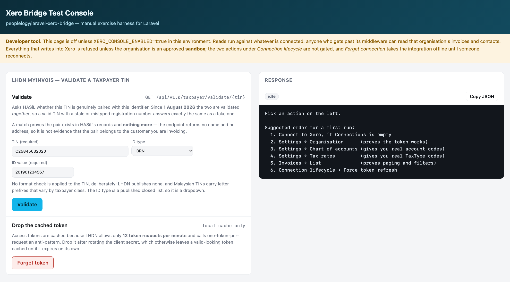
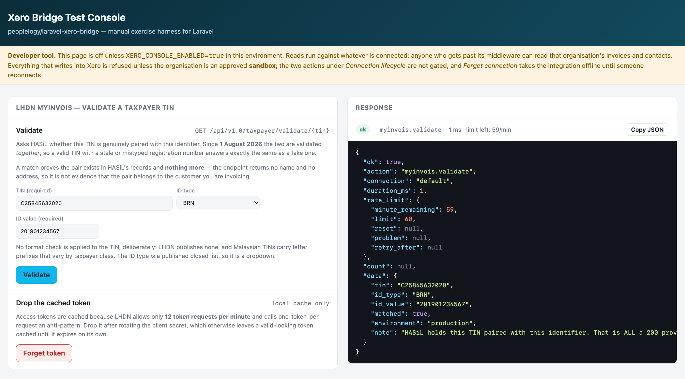
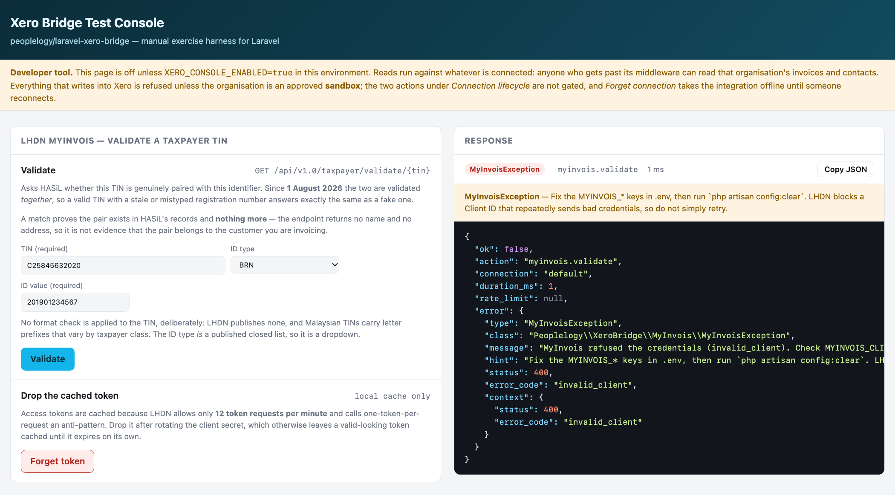

# Checking a customer's TIN with LHDN — user manual

This manual is for the people who **check customers' tax details** — finance, admin and sales-support
staff. It needs no programming knowledge.

It shows how to ask LHDN (HASiL) whether a customer's **TIN** (Tax Identification Number) is genuine
and belongs together with their **business registration number** (or, for a person, their IC or
passport number), using the **Xero Bridge Test Console** page that comes with your application.

**What it does not do:** it does not send invoices to LHDN or to Xero, and it changes nothing about
the customer. It only asks one question and shows LHDN's answer.

> **Version note.** Written against `peoplelogy/laravel-xero-bridge` v1.7.2. The screens shown are
> the package's own console; your application may show it under its own address. The TIN and
> registration number in the pictures are LHDN's published example, not a real taxpayer.

---

## Contents

1. [Before you start](#before-you-start)
2. [Step 1 — open the page](#step-1--open-the-page)
3. [Step 2 — fill in the customer's details](#step-2--fill-in-the-customers-details)
4. [Step 3 — click Validate and read the answer](#step-3--click-validate-and-read-the-answer)
5. [When the page shows an error](#when-the-page-shows-an-error)
6. [The Forget token button](#the-forget-token-button)
7. [Is my check saved?](#is-my-check-saved)
8. [Good practice](#good-practice)
9. [Quick reference](#quick-reference)
10. [For your administrator](#for-your-administrator)

---

## Before you start

### You need access to the page

The page is switched **off** until your administrator turns it on, and it is normally limited to
admin users. Ask your administrator for:

- the page's address — usually your application's address followed by **`/xero/console`**, for
  example `https://your-app.example.com/xero/console`;
- an account that is allowed to open it.

If the address shows **"404 Not Found"**, the page is not switched on in that system. If it sends
you to a sign-in page or says **"Forbidden"**, your account is not allowed to use it. Either way,
ask your administrator.

### You need three details about the customer

| Detail | For a company | For a person |
|---|---|---|
| **TIN** | The company's tax number — usually starts with **C**, e.g. `C25845632020` | The person's tax number — usually starts with **IG** |
| **ID type** | **BRN** | **NRIC** (Malaysian IC), **PASSPORT**, or **ARMY** |
| **ID value** | The **12-digit** business registration number from the SSM certificate, e.g. `201901234567` | The IC number (12 digits), the passport number, or the army number |

Type the numbers **without spaces or dashes**. For a company, always use the **new 12-digit SSM
number**: an old short-format registration number will not match, even with a correct TIN.

---

## Step 1 — open the page

Open the address your administrator gave you and sign in if asked. The page is called **Xero Bridge
Test Console**. Scroll down the **left** column to the panel headed **LHDN MyInvois — validate a
taxpayer TIN**.

The yellow **"Developer tool"** strip at the top is a reminder that this page is a tool for admins;
it is safe to use for TIN checks.

---

## Step 2 — fill in the customer's details

In the **Validate** section of the panel:

1. **TIN (required)** — type the customer's TIN.
2. **ID type** — choose from the list: **BRN** for a company, **NRIC**, **PASSPORT** or **ARMY** for
   a person. It starts on BRN.
3. **ID value (required)** — type the registration, IC, passport or army number that goes with that
   ID type.

The light grey numbers you see in empty boxes (`C25845632020`, `201901234567`) are **only examples**
of the format. They disappear when you type. If you leave a box showing grey text, nothing has been
entered.

**Both numbers are needed.** LHDN checks the TIN and the ID number **as a pair**: a genuine TIN
typed with the wrong registration number gets the same answer as a made-up one.

---

## Step 3 — click Validate and read the answer

Click the blue **Validate** button. The answer appears within a few seconds in the **Response** panel
on the **right**.

At the top of the Response panel is a coloured label:

- a **green `ok`** means LHDN answered — read **`"matched"`** in the box underneath for the answer;
- a **red label** means LHDN could not give an answer — see
  [When the page shows an error](#when-the-page-shows-an-error).

### Answer: Match — `"matched": true`

**What it means:** LHDN holds this TIN together with this registration (or IC/passport) number. The
details are genuine and belong together.

**What to do:** you can use these details on the customer's record and invoices.

**One caution:** a match does not tell you **whose** numbers they are — LHDN returns no name or
address. If you have any doubt that the numbers belong to *this* customer, compare them with the
customer's own SSM certificate or e-invoice details.

### Answer: No match — `"matched": false`

**What it means:** LHDN answered normally, but it does **not** hold this TIN together with this ID
number. The label is still green because this is an answer, not a fault.

**What to do:**

1. Check the numbers for typing mistakes, extra spaces or dashes.
2. Check the **ID type** — a company needs **BRN**, a person NRIC or passport.
3. For a company, make sure the BRN is the **new 12-digit** SSM number, not an old short one. This
   is the most common reason for "no match" with a genuine TIN.
4. If it still does not match, ask the customer to confirm their current TIN and registration
   number, and that LHDN holds them correctly. Do not keep re-trying the same numbers.

---

## When the page shows an error

A **red label** at the top of the Response panel, with a **yellow note** underneath, means LHDN could
not give an answer. Nothing is wrong with the customer's details — the problem is with the
connection to LHDN. The yellow note says what to do.

| What the response says | What it means | What to do |
|---|---|---|
| **"refused the credentials (invalid_client)"** | The application's LHDN login details are wrong, or belong to LHDN's test system instead of the live one (or the other way round) | **Stop** and tell your administrator. Do **not** keep clicking Validate — LHDN can block the account after repeated refusals |
| **"MyInvois is disabled"** or **"is missing"** / **"placeholder"** | The LHDN connection is switched off or not set up in this system | Tell your administrator |
| **Status 429** or "rate-limiting" | Too many checks in the last minute (the limit is 60 per minute for the whole application) | Wait a minute, then try once more |
| **Status 500 or 503** | LHDN's system is having problems | Try again later |
| **Status 403** | The application is not registered for LHDN's TIN-check service | Tell your administrator |
| A message about a **"connection"** or **"timed out"** | The application could not reach LHDN | Try again later; if it keeps happening, tell your administrator |

When you report a problem, use the **Copy JSON** button at the top right of the Response panel and
paste the result into your message. It contains everything the administrator needs — but if the
check was for a **person**, remove their IC or passport number before sending it on.

---

## The Forget token button

Below the Validate section is **Drop the cached token**, with a red **Forget token** button. You do
**not** need it for normal checks.

It clears the application's saved LHDN login so the next check signs in again. Use it **only when
your administrator asks you to** — usually right after they have changed the LHDN login details.
Clicking it does no harm; the next check simply takes a moment longer.

---

## Is my check saved?

That depends on how your administrator has set up the application. If **check history** is switched
on, every check you run is recorded — even ones that showed an error — with:

- **who** ran it (your user account) and **when**;
- the **answer** (match, no match, or the error);
- for a **company (BRN)** check: the TIN and registration number;
- for a **person (NRIC, passport, army)** check: **no numbers at all** — only that a check was made,
  by whom and with what result. A person's numbers are personal data and are never stored.

Ask your administrator whether it is switched on in your system.

---

## Good practice

- **Check once**, when you first set up a customer or when their details change — not before every
  invoice. LHDN expects applications to remember the answer rather than ask again and again.
- **Never run many checks quickly in a row.** The limit is 60 per minute for the whole application,
  shared by everyone using it.
- **Look at `"environment"`** in the response. **`production`** means the answer came from LHDN's
  live records. **`sandbox`** means LHDN's test system: its answers say nothing about real taxpayers.
- **Treat people's numbers with care.** Do not paste IC or passport numbers into chats, emails or
  screenshots that others can see.
- **A match is not identity proof.** It confirms the numbers are genuine and belong together, not who
  the customer is.

---

## Quick reference

| You see | It means | Do this |
|---|---|---|
| Green **ok** + **`"matched": true`** | Genuine TIN, and it belongs with this ID number | Use the details |
| Green **ok** + **`"matched": false`** | LHDN does not hold this pair | Re-check typing, ID type and the 12-digit BRN; then ask the customer |
| Red label + **invalid_client** | The application's LHDN login is wrong | Stop; tell your administrator |
| Red label + **429** | Too many checks in a minute | Wait a minute, try once |
| Red label + **500 / 503** | LHDN is having problems | Try later |
| **404** on the page itself | The page is not switched on here | Ask your administrator |
| Grey numbers in the boxes | Format examples only | Type the real numbers |

---

## For your administrator

Everything a developer needs is in the **MyInvois usage** guide in this folder. In short, the panel
appears only when all of these are set in the application's environment file:

| Setting | Value |
|---|---|
| `XERO_CONSOLE_ENABLED` | `true` — the console page itself |
| `XERO_CONSOLE_MIDDLEWARE` | Limit it to admins, e.g. `web,auth,role:admin\|super_admin` |
| `MYINVOIS_ENABLED` | `true` |
| `MYINVOIS_ENVIRONMENT` | `production` or `sandbox` — **must match the LHDN portal the login came from** |
| `MYINVOIS_CLIENT_ID`, `MYINVOIS_CLIENT_SECRET` | From the MyInvois portal, under the company's ERP registration |
| `MYINVOIS_HISTORY` | `true` to record every check (optional; needs its table migrated) |

After changing any of them, run `php artisan config:clear` where the configuration is cached.
